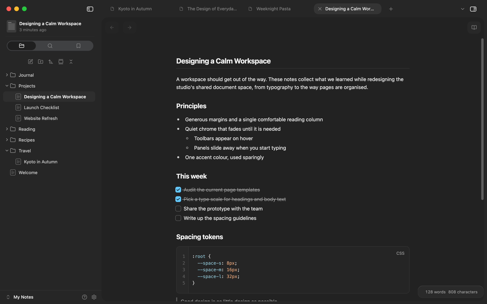
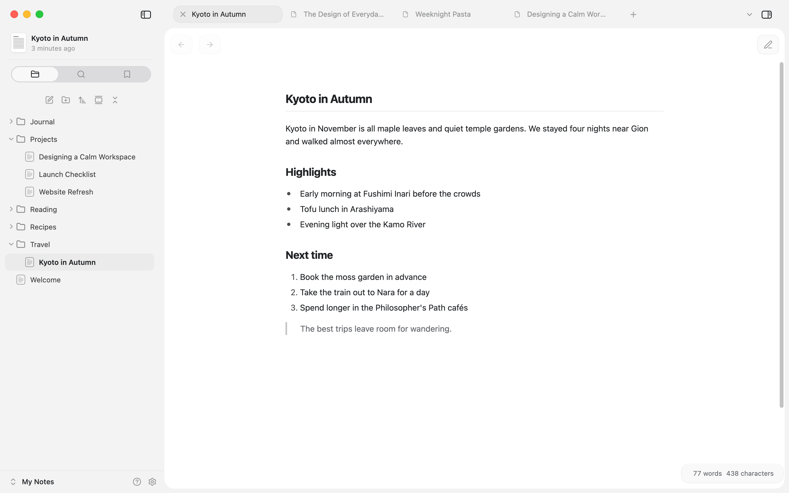

# Craft Style

An Obsidian theme modelled on the default look of the [Craft](https://www.craft.do) app: a single comfortable reading column, quiet chrome, pill-shaped tabs and Craft's "Original" colours, in light and dark.

> Unofficial. Craft Style is not affiliated with or endorsed by Craft Docs, and it ships none of Craft's code or assets.

## Features

- Craft's page colours, type scale and spacing, matched to measurements of the Craft app, so editing and reading view keep the same rhythm
- Pill tabs, a floating page header with breadcrumbs, and Craft's sidebar toggle glyph
- A folder list with Craft's row height and indents, and default folder and page icons. Rows that have an [Iconize](https://github.com/FlorianWoelki/obsidian-iconize) icon keep it
- Round bullets with a hollow second level, hanging checkboxes and numbered lists on the same indent
- Hairline inline code, code blocks with a line-number gutter, and slim pill scrollbars
- Glass menus, popovers and modals

## Install

### Theme

1. In your vault, create the folder `.obsidian/themes/Craft Style`.
2. Copy `manifest.json` and `theme.css` from this repository into it.
3. Open **Settings → Appearance → Themes** and pick **Craft Style**.

### Companion plugin (optional, desktop only)

The plugin adds the parts CSS can't do on its own: line numbers in code blocks, the document header at the top of the sidebar, and the lens effect on the sidebar's tab switcher.

1. Create the folder `.obsidian/plugins/craft-style-companion`.
2. Copy `main.js`, `manifest.json` and `styles.css` from `companion-plugin/` into it.
3. Open **Settings → Community plugins**, turn off Restricted mode if needed, and enable **Craft Style Companion**.

## Fonts

The theme defaults to the system font at 15px, as Craft does. The text and interface fonts and the font size under **Settings → Appearance** replace those defaults, and the theme's spacing scales with the size you choose.

## Compatibility

- Obsidian 1.15 or later
- Designed and tested on macOS, where the window's top bar is laid out around the traffic lights. Windows and Linux work, but the top bar hasn't been tuned there
- Light and dark mode

## License

[MIT](LICENSE)
